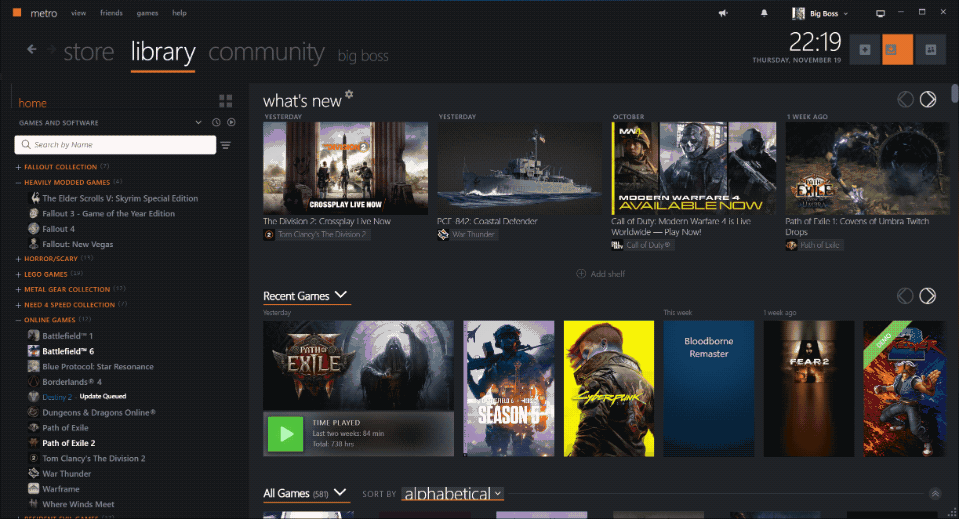
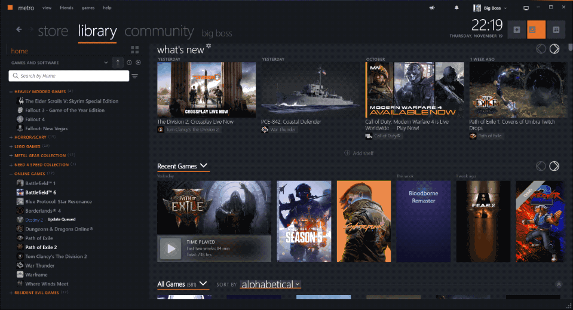

# Metro

**Modern industrial minimalism.** From the concept pack's METRO direction. A Steam client theme for [Beyond Steam](https://github.com/OriginalSwayze/Beyond-Steam) and [Millennium](https://steambrew.app).

- **Pivot headers:** Store / Library / Community set as huge light lowercase words across the top. The current one is bright and the rest are dimmed, with an accent bar sliding under the active word.
- **Flat everything:** squared graphite and gunmetal planes with no glass, glow or gradients, and one burnt-orange accent.
- **Large typography and generous spacing:** light lowercase headings with an accent line that sweeps in under each section.
- **A lock-screen clock** on the pivot row, and the dock as flat square tiles beside it.
- The selected game is a **solid accent bar**. Covers are flat tiles that press in when clicked, and Play is a flat accent rectangle.
- Notifications are flat accent tiles sliding in, and a thin accent line runs across the header.

## Install

- **With [Beyond Steam](https://github.com/OriginalSwayze/Beyond-Steam) (easiest):** in Steam press **Ctrl+Shift+B**, open
  **Get more** and install **Metro**.
- **By hand:** download **Metro.zip** from the [latest release](https://github.com/OriginalSwayze/Metro/releases/latest) and unzip
  it into `%APPDATA%\Beyond Steam\themes\Metro` (Beyond Steam) or `Steam\millennium\themes\Metro` (Millennium).

## Options

In Beyond Steam's **Theme options** tab (or **Millennium → Themes → Metro**) you can change:

Accent colour (Burnt orange, Amber, Cobalt, Lime, Magenta) · Accent line · Density · What's New · Readout · Startup screen · Motion · Cover hover · Privacy · Contrast · Focus rings · Text size

Everything here is original: no other game's names, logos, art or fonts. Fonts are ones that ship with Windows.

## License

MIT, see [LICENSE](LICENSE).
